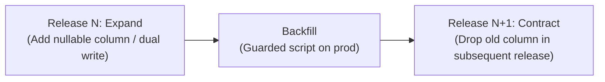

# Release and Deployment Engineering Guide

This document defines the strict pre-release validation gates, zero-downtime deployment procedure on Google Cloud Run, and rollback mechanisms for the application.

---

## 1. Zero-Downtime Rule: Expand / Contract Schema Migrations

When altering the database schema, **never drop columns or rename existing tables in the same release as the application code that stops using them**. Cloud Run scales to zero and can have multiple revisions serving concurrently during traffic shifts.

Follow the two-phase **Expand / Contract** pattern:



### Phase 1: Expand (Release N)
1. Add new columns as **nullable** or with a database `DEFAULT`.
2. Deploy application code that reads the new column (with fallback to old column) and writes to both.
3. Apply migration to production using the production guard.

### Phase 2: Data Backfill
1. Run a guarded one-off script to backfill existing records:
   ```bash
   DEPLOY_ENV=production npx tsx scripts/backfill-semester-user.ts <USER_ID> --execute --i-know-this-is-production
   ```

### Phase 3: Contract (Release N+1)
1. Deploy code that strictly uses the new column and drops references to the old column.
2. In a subsequent migration, safely drop the old column:
   ```prisma
   // Remove deprecated column from schema.prisma
   ```

---

## 2. Pre-Release Verification Gate

Every release must pass all four gates locally before deploying images to GCP:

### Gate 1: Type Checking, Linting, and Automated Unit Tests
```bash
npm run test:ci
```
*(Executes `tsc --noEmit`, `eslint`, and all `vitest` unit tests. Must exit with code 0).*

### Gate 2: Turbopack Standalone Build
```bash
npm run build
```
*(Verifies Next.js 16 standalone bundling and ensures memory usage remains within the 4096MB node heap. Note: `cloudbuild.yaml` uses the free-tier default build machine; if a Cloud Build Docker build hits an OOM error, `machineType: E2_HIGHCPU_8` can be temporarily added back under `options:` in `cloudbuild.yaml`.)*

### Gate 3: Resource-Constrained Container Smoke Test
```bash
npm run docker:smoke
```
*(Builds the multi-stage Docker image and executes a container limited to `--memory=512m --cpus=1` to prove the server starts without OOM errors on Cloud Run).*

### Gate 4: Migration Rehearsal on Restored Production DB
Restore a recent `pg_dump` of the production database into a local or staging PostgreSQL container, then run:
```bash
DEPLOY_ENV=staging npx prisma migrate deploy
```
*(Verifies that pending migrations execute cleanly without table locks or schema drift).*

---

## 3. Production Migration Procedure

When applying migrations to the live production database, the production safety guard must be explicitly acknowledged:

### Pre-Migration Drift Check & Baselining

> [!WARNING]
> **Schema Drift Check Required:** Before applying any migration to production, compare the production schema to `prisma/migrations` with `prisma migrate diff`, and baseline if they differ:
>
> ```bash
> # 1. Inspect differences between production DB and migrations folder:
> npx prisma migrate diff \
>   --from-url "$DATABASE_URL" \
>   --to-migrations ./prisma/migrations \
>   --exit-code
>
> # 2. If the diff indicates production already has tables/columns from an existing migration
> # (e.g. created manually or out-of-band), baseline the migration history:
> npx prisma migrate resolve --applied <migration_directory_name>
> ```

### Executing Migrations

```bash
# Verify connection and guard:
DEPLOY_ENV=production npx tsx scripts/guard.ts --i-know-this-is-production

# Apply migrations to production database:
DEPLOY_ENV=production DATABASE_URL="<PROD_DIRECT_DATABASE_URL>" npx prisma migrate deploy
```

---

## 4. Tagged No-Traffic Deployment on Cloud Run

We deploy revisions using Cloud Run revision tags without routing traffic immediately. This allows end-to-end verification on a physical phone using the private revision URL before exposing changes to users.

### Step 1: Build and Push Container Image to Artifact Registry
```bash
# Set environment variables
export GCP_PROJECT_ID="your-gcp-project-id"
export GCP_REGION="asia-south1"
export COMMIT_SHA=$(git rev-parse --short HEAD)
export IMAGE_TAG="gcr.io/${GCP_PROJECT_ID}/dashboard-management:${COMMIT_SHA}"

# Build container with production build args:
docker build \
  --build-arg NEXT_PUBLIC_SUPABASE_URL="https://<your-supabase-id>.supabase.co" \
  --build-arg NEXT_PUBLIC_SUPABASE_PUBLISHABLE_KEY="<your-supabase-anon-key>" \
  --build-arg NEXT_PUBLIC_VAPID_PUBLIC_KEY="<your-vapid-public-key>" \
  -t "${IMAGE_TAG}" .

# Push image to registry
docker push "${IMAGE_TAG}"
```

### Step 2: Deploy Tagged No-Traffic Revision
Deploy the revision with `--no-traffic` and tag it as `staging`:

```bash
gcloud run deploy dashboard \
  --image "${IMAGE_TAG}" \
  --region "${GCP_REGION}" \
  --project "${GCP_PROJECT_ID}" \
  --platform managed \
  --no-traffic \
  --tag staging \
  --memory 512Mi \
  --cpu 1 \
  --min-instances 0 \
  --max-instances 2 \
  --set-env-vars "DEPLOY_ENV=production,NODE_ENV=production,CRON_OIDC_AUDIENCE=dashboard-management-cron,CRON_OIDC_SERVICE_ACCOUNT_EMAIL=scheduler-invoker@dashboard-management-prod.iam.gserviceaccount.com,S3_BUCKET_NAME=dashboard,S3_REGION=us-east-1" \
  --set-secrets "DATABASE_URL=DATABASE_URL:latest,CRON_BEARER_TOKEN=CRON_BEARER_TOKEN:latest,S3_ACCESS_KEY_ID=S3_ACCESS_KEY_ID:latest,S3_SECRET_ACCESS_KEY=S3_SECRET_ACCESS_KEY:latest,S3_ENDPOINT=S3_ENDPOINT:latest,S3_PUBLIC_ENDPOINT=S3_PUBLIC_ENDPOINT:latest,VAPID_PRIVATE_KEY=VAPID_PRIVATE_KEY:latest,OPENROUTER_API_KEY=OPENROUTER_API_KEY:latest"
```

### Step 3: Verify on Physical Phone
Cloud Run generates a dedicated tag URL:
```text
https://staging---dashboard-<hash>-<region>.a.run.app
```
Open this URL on your phone and run through the checklist in `docs/TEST_PLAN.md` (PWA rendering, auth redirect, attendance mark, PDF opening).

---

## 5. Shifting Live Traffic

Once the tagged revision passes all verification tests on your phone, shift 100% of production traffic to it:

```bash
gcloud run services update-traffic dashboard \
  --region "${GCP_REGION}" \
  --project "${GCP_PROJECT_ID}" \
  --to-tags staging=100
```

Verify the live URL:
```bash
curl -I https://dashboard-<hash>-<region>.a.run.app
```

---

## 6. Instant Rollback Procedure

If any issue, error spike, or regression is detected after shifting traffic, roll back immediately to the previous revision.

### Step 1: List Past Cloud Run Revisions
```bash
gcloud run revisions list \
  --service dashboard \
  --region "${GCP_REGION}" \
  --project "${GCP_PROJECT_ID}" \
  --format="table(name,active,creationTimestamp)"
```

### Step 2: Revert 100% Traffic to the Previous Revision
Replace `<PREVIOUS_REVISION_NAME>` with the revision identifier from step 1:

```bash
gcloud run services update-traffic dashboard \
  --region "${GCP_REGION}" \
  --project "${GCP_PROJECT_ID}" \
  --to-revisions "<PREVIOUS_REVISION_NAME>=100"
```

This routes 100% of incoming requests back to the previous healthy container in less than 2 seconds without requiring a redeploy or code changes.
